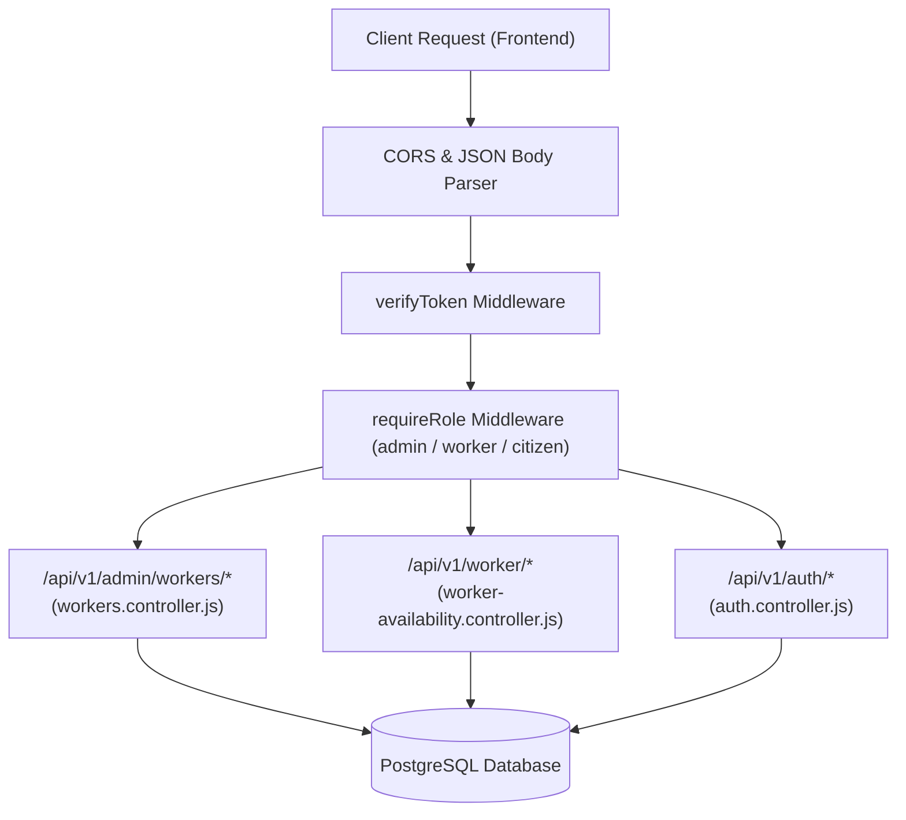

# TrashTrack AI — Backend API Documentation

The TrashTrack AI backend is a modular, high-performance Node.js & Express API designed for municipal waste management, worker verification, and live telematics tracking.

---

## 🛠️ Tech Stack & Architecture

- **Runtime**: Node.js (ES Modules)
- **Framework**: Express.js 5
- **Database**: PostgreSQL with relational constraints and connection pooling (`pg`)
- **Validation**: Zod schema parsing
- **Security & Cryptography**: BCrypt.js for password hashing, JWT (JSON Web Tokens) for session authentication

---

## 🗃️ Database Migrations

Migrations are stored in `/backend/migrations`:

| Migration | Purpose | Key Tables / Additions |
| :--- | :--- | :--- |
| `001_create_complaints.sql` | Core schema | `users`, `complaints`, `municipalities` |
| `002_add_coordinates.sql` | Geolocation support | Lat/Lng coordinates for complaints |
| `003_add_address_phone.sql` | User profile extensions | `phone_number`, `address` in `users` |
| `004_worker_approvals.sql` | Worker verification system | `worker_approvals` table, `status` enum |
| `005_worker_availability.sql`| Duty availability & telematics | `worker_sessions` table, `availability_status` in `users` |

---

## 🔄 Backend Architectural Flow



---

## 🔌 API Endpoints Summary

### 1. Worker Duty (`/api/v1/worker/*`)
- `GET /availability` — Retrieves current live duty state, active session, and today's accumulated duration.
- `POST /availability/toggle` — Toggles worker between `ACTIVE` and `INACTIVE` duty with transactional checks.
- `POST /availability/heartbeat` — Periodic heartbeat (every 90s) to keep sessions alive and prevent inactivity timeouts.

### 2. Admin Workforce (`/api/v1/admin/workers/*`)
- `GET /` — Lists all workers within the admin's municipal jurisdiction with status filtering.
- `GET /pending` — Lists pending worker identity and area allocation requests.
- `GET /pending-count` — Returns badge count for pending reviews.
- `GET /:id` — Detailed worker profile.
- `POST /:id/approve` — Approves worker registration and assigns municipality ID.
- `POST /:id/reject` — Rejects worker with audit reason string.
- `GET /availability/live` — Live monitoring table across all workers.
- `GET /:id/working-hours` — Historical shift sessions and 7-day distribution.
- `POST /:id/close-session` — Administrative remote session closure.

---

## 🧪 Automated Testing

Run the automated test suites:
```bash
# Run Worker Approval & Lifecycle Test Suite
node test-worker-approval.mjs
```
