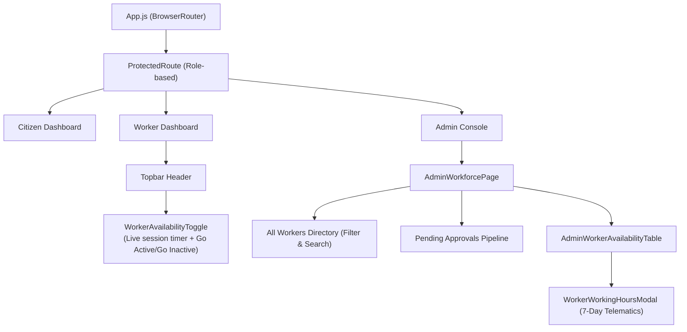

# TrashTrack AI — Frontend Web Application

The TrashTrack AI frontend is a responsive Single Page Application (SPA) built with React 18, Vite, and Tailwind CSS. It provides tailored dashboard experiences for Citizens, Sanitation Workers, and Municipal Administrators.

---

## 🎨 UI Architecture & Features

- **Component Design System**: Built with modern dark glassmorphism, responsive flex/grid layouts, and Lucide React icons.
- **Interactive Mapping**: Leaflet and React-Leaflet integration with OpenStreetMap tiles for geolocation visualization.
- **State Management**:
  - `AuthContext`: Centralized JWT authentication, session hydration via `/api/v1/auth/me`, and role-based route protection.
  - `LocationContext`: Geolocation acquisition and reverse-geocoding.

---

## 🔄 Frontend Component & Flow Architecture



---

## 📂 Key Components Directory

| Path | Component | Purpose |
| :--- | :--- | :--- |
| `src/pages/admin/AdminWorkforcePage.js` | Workforce Hub | Tabs for All Workers, Approvals, Availability, Workload, and Performance. |
| `src/components/admin/AdminWorkerAvailabilityTable.js` | Live Duty Table | Real-time worker monitoring table with pulse badges, timers, and filters. |
| `src/components/admin/WorkerWorkingHoursModal.js` | Hours History | Modal displaying 7-day bar chart and detailed historical shift logs. |
| `src/components/worker/WorkerAvailabilityToggle.js` | Availability Toggle | Top-bar button for workers to go Active/Inactive with live timer and guard modals. |
| `src/components/worker/WorkerLayout.js` | Worker Frame | Worker portal layout housing the top navigation and availability toggle. |

---

## 🚀 Build & Scripts

```bash
# Install dependencies
npm install

# Start local Vite dev server
npm run dev

# Compile production bundle
npm run build
```
